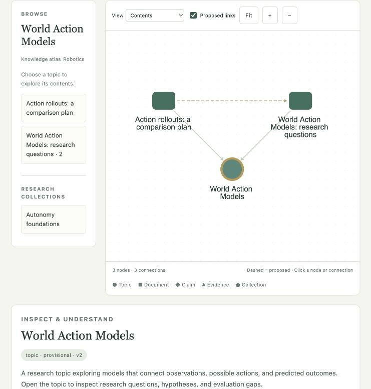

# REER Knowledge Graph

An extensible local knowledge atlas: topics, documents, claims, evidence, and research collections. Explore a small area at a time, propose where new material belongs, and inspect the evidence behind each relationship.



[View the connection explanation panel](docs/connection-details.jpg)

This is an independent public component alongside [Document Formatter](https://github.com/reer-robotics/document-formatter) and [Reading Assistant](https://github.com/reer-robotics/reading-assistant). It does not change those repositories or the company journal.

## Run the demo

Python 3.11+ is required. No model download or frontend build is needed. Cytoscape.js is vendored from the official npm release with its license and integrity record.

```sh
python3 -m venv .venv
source .venv/bin/activate
python -m pip install -e '.[dev]'
knowledge-map serve --port 4175
```

Open **http://127.0.0.1:4175/**. The first launch seeds an empty local database with **synthetic** examples; subsequent launches retain your edits in `workspace/graph.sqlite3`. Nothing is uploaded to GitHub.

- **All domains:** start with Robotics, AI, Physics and Mathematics.
- Select a node for a short description and a preview of its children, then **Explore topic →** (or **Explore contents →**) to move down a layer. Use Back or the breadcrumb buttons to return. Canvas +/− and the mouse wheel control geometric zoom; layer changes are explicit navigation, not automatic camera thresholds.
- **Robotics → Explore topic → World Action Models:** descend directly into subtopics. Click any connection to see both endpoint summaries, its reasoning, evidence excerpts, and review status.
- **Try example content:** add action-rollout, motion-model, or abstract-algebra notes. Suggestions start as proposals; the algebra example does not need a Robotics link. Saved examples reopen without creating duplicates.
- **Explore World Action Models:** inspect a cross-domain investigation, its claims/evidence, and proposed foundations.
- **Autonomy foundations:** a research collection shares the same canonical documents across subject boundaries.
- **Add knowledge → Example document → Save locally:** add a trajectory investigation under Unclassified. Choose **Suggest connections**, inspect the proposal, and **Add to review queue**. Accept or reject individual relationships.
- **Example new topic:** add Geometry under Mathematics without changing the application code. Or create any new topic with a unique ID and optional parent.
- **Revise content:** save a new revision. Affected knowledge relationships become stale; existing history is preserved.

The sidebar is an accessible alternative to selecting canvas nodes. Documents can belong to several topics and collections without duplication. Independent content is allowed.

## What is implemented

| Capability | Implementation |
| --- | --- |
| Storage | SQLite transactions, node revisions, relationship decisions and mutation history |
| Extensible subjects | Topic records with titles, descriptions, tags and aliases; multiple parent topics, cycle checks |
| Content profiles | JSON schemas for notes, experiments, theorem worksheets and physics models; trusted custom schema directory |
| Ranking | Reciprocal rank fusion of title/tag/alias overlap and body overlap; keyword proposals also require shared subject tags (title terms when tags are absent); relevance is not credibility |
| Suggestions | Keyword classification and `related_to` proposals by default |
| Optional AI | One installed local Ollama model, separate classify/relate/verify skill passes |
| Review | Proposed / accepted / rejected / stale relationship states; exact quoted evidence for factual links |
| Views | Contents, connections, foundations, claims/evidence, research collections, and search |
| Browser memory | At most 150 nodes / 300 edges per view; bodies fetched on selection; ten cached layouts; old elements removed |

Maturity is curator metadata, separate from relevance. The theorem profile permits only `unverified` proof status in this release. Its schema checks that fields exist; it does not verify mathematics. Physics profiles require equations, units, assumptions and validity descriptions; they do not perform dimensional analysis.

Updated bundled descriptions and topic placements apply to newly initialized workspaces. Existing databases retain their content and decisions; no automatic reseeding or overwriting occurs. The example gallery also works in existing workspaces.

## Optional local model

```sh
knowledge-map --model YOUR_INSTALLED_MODEL serve --port 4175
```

The model must already be installed in Ollama at `http://127.0.0.1:11434` and support completion with structured JSON. No downloads, cloud fallback, web browsing, embeddings, or autonomous writes are performed. The three passes use the same configured model. A verification pass is not independent scientific review.

Model calls are tested with mocks; real-model semantic quality and latency have **not** been evaluated. Without a model, the demo honestly labels keyword suggestions and never infers support or contradiction from similarity.

## Library and CLI

```python
from knowledge_graph.core import Graph, resource
from knowledge_graph.workflow import propose, apply

graph = Graph('workspace/my-map.sqlite3', audiences=['demo'])
graph.import_bundle(resource('demo/base.json'))  # once, on an empty database
node = graph.add_node(resource('demo/new-content.json'), parent='unclassified')
proposal = propose(graph, node['id'])
apply(graph, proposal['id'])  # saves proposed edges, not accepted edges
view = graph.view('unclassified', mode='children')
```

```sh
knowledge-map --db workspace/new.sqlite3 init --minimal
knowledge-map --db workspace/new.sqlite3 import src/knowledge_graph/demo/cross-domain.json
knowledge-map --db workspace/new.sqlite3 view --focus wam-survey --mode neighbors --proposed
knowledge-map --db workspace/new.sqlite3 propose wam-survey
```

Global options precede the subcommand. `init` is explicit and refuses duplicate IDs. The browser's Export produces a filtered snapshot for inspection, not an import bundle or a complete backup. Back up the SQLite file while the service is stopped to preserve history and pending proposals.

## Extend and contribute

- [Data model, ranking and workflow](docs/architecture.md)
- [Add new domains and content profiles](docs/extending.md)
- [HTTP, library and journal integration](docs/integration.md)
- [Contribution guide](CONTRIBUTING.md)
- [Security and limits](SECURITY.md)

```sh
pytest -q
node --test tests/state.test.mjs  # Node 22+
python examples/run_demo.py
python examples/content_fit.py
python -m pip wheel --no-deps . -w dist
```

## Prototype boundaries

This is a single-user localhost tool, not an authenticated hosted service. Trusted audience labels demonstrate filtering; they are not SSO. Real catalogs and SQLite workspaces must stay outside public Git history.

Backend queries currently read the graph into Python memory. Browser view limits do not make this a large-scale database implementation. Content must be supplied as structured nodes/bundles; PDF ingestion, automated theorem proving, semantic embeddings, graph centrality ranking, Leiden clustering, automatic topic merging, aggregated cross-cluster statistics, and continuous semantic zoom are future work. The initial renderer uses deterministic cached positions rather than a continuously running force simulation. No performance ceiling is claimed without workload benchmarks.

## Renderer provenance

[Cytoscape.js](https://js.cytoscape.org/) provides the interactive canvas renderer. The exact release and npm integrity are in `vendor-lock.json`; its license is retained in `web/vendor/CYTOSCAPE-LICENSE`. `python scripts/vendor_cytoscape.py` refreshes the pinned artifact with integrity verification. This is a maintenance command requiring network access, not a runtime dependency.
